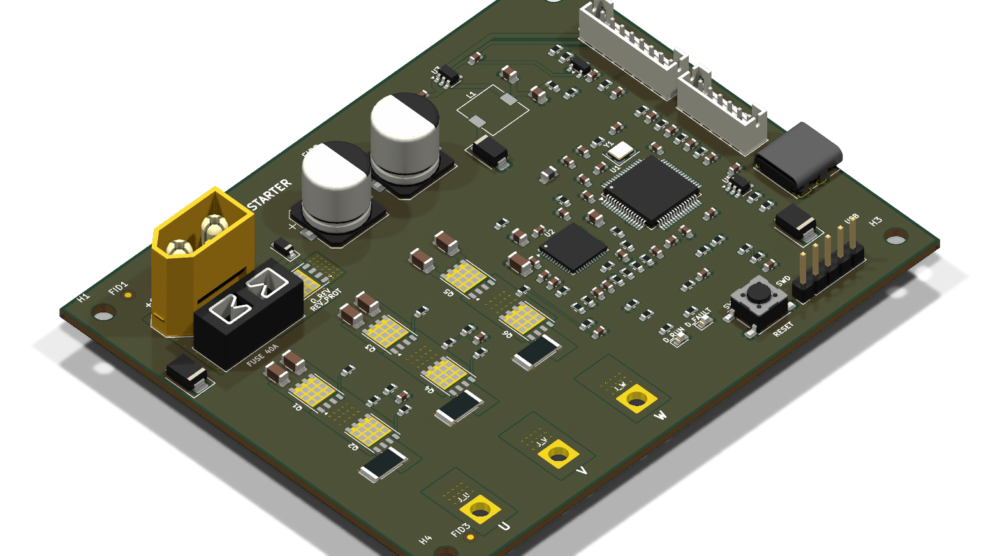

# Vera — Starter Motor System

Custom VESC 6-based motor controller developed for the **Vera** Shell Eco-marathon ICE vehicle. It drives a sensored TP Power TP4050 brushless motor through a 6.67:1 belt reduction to reliably crank a rebuilt Honda GX35 4-stroke engine (900–1,200 RPM) at ultra-low energy consumption (<30 Joules per start).

  

## Overview

* **HW/**: KiCad design files for the custom 4-layer STM32F405 + TI DRV8323RS motor controller (`HW/vera_vesc_starter.kicad_pro`).
* **SW/**: [VEDDERB BLDC Firmware](https://github.com/vedderb/bldc) tracked as a Git submodule.

## Quick Start

Mjau